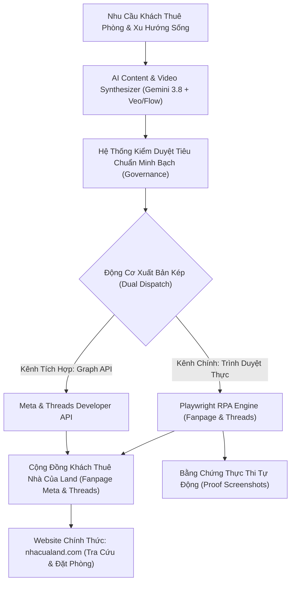

# CẨM NANG TOÀN DIỆN THƯƠNG HIỆU & HỆ THỐNG TỰ ĐỘNG HÓA AI AGENT
**Thương hiệu:** Nhà Của Land (nhacualand.com)  
**Lĩnh vực:** Nền tảng chuyên Cho Thuê Các Loại Phòng (Studio, Căn hộ dịch vụ, Chung cư mini, Phòng trọ cao cấp)  
**Hệ điều hành:** AI Agent Enterprise Operating System  
**Phiên bản:** v4.0 · **Cập nhật:** 2026

---

## MỤC LỤC
1. [TỔNG QUAN HỆ ĐIỀU HÀNH THƯƠNG HIỆU NHÀ CỦA LAND](#1-tổng-quan-hệ-điều-hành-thương-hiệu-nhà-của-land)
2. [ĐỊNH VỊ THƯƠNG HIỆU & BẢN SẮC CỐT LÕI NHÀ CỦA LAND](#2-định-vị-thương-hiệu--bản-sắc-cốt-lõi-nhà-của-land)
3. [BỘ QUY CHUẨN NHẬN DIỆN THƯƠNG HIỆU (BRAND TOKENS)](#3-bộ-quy-chuẩn-nhận-diện-thương-hiệu-brand-tokens)
4. [MA TRẬN NỘI DUNG & 4 TRỤ CỘT TRUYỀN THÔNG ĐA KÊNH](#4-ma-trận-nội-dung--4-trụ-cột-truyền-thông-đa-kênh)
5. [QUY TRÌNH TỰ ĐỘNG HÓA PLAYWRIGHT TRÊN FANPAGE & THREADS](#5-quy-trình-tự-động-hóa-playwright-trên-fanpage--threads)
6. [HỆ THỐNG SẢN XUẤT SHORTVIDEO ROOM TOUR & 20 HYPERFRAMES SKILLS](#6-hệ-thống-sản-xuất-shortvideo-room-tour--20-hyperframes-skills)
7. [CHÍNH SÁCH BẢO MẬT & QUẢN TRỊ RỦI RO TÀI KHOẢN META](#7-chính-sách-bảo-mật--quản-trị-rủi-ro-tài-khoản-meta)

---

## 1. TỔNG QUAN HỆ ĐIỀU HÀNH THƯƠNG HIỆU NHÀ CỦA LAND

Hệ thống AI Agent Nhà Của Land vận hành cô lập 100% duy nhất tại `D:\Facebook` theo triết lý **100% Zero-Human-Approval Autonomous Direct Dispatch (Tự động hóa hoàn toàn ngầm không qua duyệt tay)**:
- Người dùng chỉ ra lệnh hoặc để hệ thống tự động chạy theo lịch biểu (`run_daily.cmd` / `npm run orchestrate`).
- AI Agent tự động kết hợp **Gemini 3.8 Flash** để sáng tạo bài viết đa kênh, **Google Flow Image Studio & Nano Banana 2.1** để tạo ảnh kiến trúc 4K, **Google Flow PRO / Veo & Omni 1.1 Flash** để tạo Room Tour 9:16 và điều khiển Dual-Engine (Graph API + Playwright `Profile 38`) để đăng trực tiếp lên cả 3 kênh: **Meta Facebook Fanpage**, **Instagram** và **Threads**.
- Người dùng không phải bấm duyệt hay xác nhận từng bài, chỉ cần mở kho bằng chứng (`data/screenshots/` và `data/publish_history.json`) để kiểm tra thành phẩm.

---

## 2. ĐỊNH VỊ THƯƠNG HIỆU & BẢN SẮC CỐT LÕI NHÀ CỦA LAND

- **Tên thương hiệu:** Nhà Của Land
- **Slogan:** *"Tìm phòng ưng ý, an cư trọn vẹn — Không gian sống tiện nghi"*
- **Website chính thức:** [https://nhacualand.com](https://nhacualand.com)
- **Lĩnh vực kinh doanh trọng tâm:**
  - Phòng trọ cao cấp khép kín, có gác lửng thoáng mát.
  - Phòng Studio full nội thất hiện đại (điều hòa, nóng lạnh, tủ lạnh, bếp riêng, máy giặt).
  - Căn hộ dịch vụ mini 1PN - 2PN dành cho người đi làm, chuyên gia và gia đình trẻ.
  - Chung cư mini văn minh, bảo vệ/camera 24/7, khóa vân tay và PCCC đạt chuẩn.
- **Tính cách thương hiệu (Brand Persona):**
  - **Minh bạch & Trung thực (Transparent):** 100% Ảnh phòng thật, giá thuê niêm yết công khai, không chi phí phát sinh bất thường.
  - **Tận tâm & Nhanh chóng (Caring & Responsive):** Hỗ trợ đặt lịch xem phòng nhanh, giải quyết sự cố kỹ thuật trong 24h.
  - **An tâm tuyệt đối (Secure):** Đảm bảo an ninh, phòng cháy chữa cháy và pháp lý hợp đồng rõ ràng.

---

## 3. BỘ QUY CHUẨN NHẬN DIỆN THƯƠNG HIỆU (BRAND TOKENS)

### 3.1. Bảng màu chủ đạo (Color Palette)
- **Ocean Teal (Màu thương hiệu chính):** `#0D5C75` — Thể hiện sự uy tín, an tâm, mát mẻ và sạch sẽ của không gian sống.
- **Warm Orange (Màu điểm nhấn):** `#FF7A00` — Sự năng động, nhiệt huyết, ấm áp như ánh đèn trong tổ ấm.
- **Forest Green (Màu tin cậy):** `#2B8A3E` — Tượng trưng cho sự an cư lạc nghiệp, phát triển vững bền.
- **Pure White / Light Slate (Màu nền):** `#F7F9FA` & `#FFFFFF` — Đem lại cảm giác rộng rãi, tinh khôi, thoáng mát.

### 3.2. Kiểu chữ (Typography)
- **Tiêu đề (Headings):** Modern Sans-serif (`Plus Jakarta Sans`, `Montserrat`).
- **Nội dung (Body Text):** Rõ ràng, dễ đọc trên thiết bị di động (`Inter`, `-apple-system`).

---

## 4. MA TRẬN NỘI DUNG & 4 TRỤ CỘT TRUYỀN THÔNG ĐA KÊNH

Kế hoạch nội dung được thiết kế phân bổ tối ưu nhằm xây dựng nhận diện thương hiệu và điều hướng khách thuê về website:

| Trụ Cột | Tỉ Trọng | Mục Tiêu Chính | Định Dạng Khuyên Dùng |
| :--- | :---: | :--- | :--- |
| **P1: Không Gian Sống & Tiện Nghi Phòng** | 35% | Giới thiệu cận cảnh phòng đẹp, full nội thất, ánh sáng tự nhiên | Video Reels Room Tour 9:16, Carousel ảnh thật |
| **P2: Vị Trí Đắc Địa & Kết Nối Tiện Lợi** | 25% | Nhấn mạnh tiện ích gần trường ĐH, văn phòng, siêu thị, giao thông | Album bản đồ vị trí, Infographic bán kính di chuyển |
| **P3: Bí Quyết Thuê Phòng & An Cư Trọn Vẹn** | 25% | Chia sẻ mẹo xem phòng, kinh nghiệm tiết kiệm chi phí, an toàn PCCC | Short Tips, Video chuyên gia hướng dẫn |
| **P4: Minh Bạch Giá Thuê & Trải Nghiệm Cư Dân** | 15% | Củng cố lòng tin, review thực tế, ưu đãi giữ phòng online | Feedback khách thuê, Ảnh bàn giao phòng |

---

## 5. QUY TRÌNH TỰ ĐỘNG HÓA PLAYWRIGHT TRÊN FANPAGE & THREADS

Hệ thống áp dụng công nghệ **Playwright Stealth Browser Automation**:
1. **Duy trì Persistent Profile (`data/browser_profile`)**: Đăng nhập 1 lần qua `npm run social:session`, sau đó Agent tái sử dụng phiên vĩnh viễn mà không bao giờ bị hỏi lại mật khẩu.
2. **Mô phỏng hành vi người dùng thật (Human Jitter)**: Gõ phím với độ trễ biến thiên ngẫu nhiên (35ms - 75ms), rê chuột tự nhiên và giãn cách thao tác tránh bị thuật toán Meta nghi ngờ bot.
3. **Cơ chế ngắt mạch an toàn (Emergency Circuit Breaker)**: Quét tự động các cảnh báo lạ (checkpoint, khóa tạm thời). Nếu phát hiện bất thường, lập tức dừng lại, chụp ảnh hiện trường và thông báo an toàn.
4. **Đối soát tự động (Proof Capture)**: Mỗi bài đăng đều chụp lại ảnh màn hình bằng chứng tại `data/screenshots/publish_proof_{timestamp}.png`.

---

## 6. HỆ THỐNG SẢN XUẤT SHORTVIDEO ROOM TOUR & 20 HYPERFRAMES SKILLS

Hệ sinh thái sở hữu bộ 20 kỹ năng Hyperframes chuyên sâu kết hợp cùng Google Flow / Veo:
1. **hyperframes**: Điều phối luồng render và xuất bản video.
2. **embedded-captions**: Tự động nhận diện giọng nói, sinh subtitle động kinetic nổi bật từng từ khóa.
3. **faceless-explainer**: Dựng video chia sẻ kinh nghiệm thuê phòng không lộ mặt kết hợp Voiceover AI.
4. **hyperframes-audio**: Chuẩn hóa âm lượng nhạc nền và voiceover đạt chuẩn -14 LUFS, tự động ducking nhạc nền khi có thuyết minh.
5. **slideshow**: Tạo video slideshow ảnh phòng chuyển động Ken Burns mượt mà.
6. **veo_video_engine**: Sinh các cảnh quay điện ảnh góc rộng về không gian căn hộ, ánh sáng ban mai và nội thất sang trọng.

---

## 7. CHÍNH SÁCH BẢO MẬT & QUẢN TRỊ RỦI RO TÀI KHOẢN META

- **Không chia sẻ thông tin tài khoản ngoài phạm vi được chỉ định**.
- **Kiểm soát tần suất đăng bài**: Tối đa 5 bài/ngày trên mỗi kênh, giãn cách tối thiểu 30 phút giữa các bài đăng liên tiếp.
- **Bộ lọc từ cấm nghiêm ngặt**: Loại bỏ hoàn toàn các từ ngữ lừa đảo cọc, phòng ảo, mồi chài tương tác vi phạm chính sách Meta.

---

## 8. NGUYÊN TẮC THỊ GIÁC TỐI GIẢN (MINIMALIST VISUAL MANDATE)

1. **VỀ HÌNH ẢNH (CAROUSEL & MEME):**
   - Thêm rất ít chữ, tuyệt đối không chèn quá nhiều chữ hay icon/ký hiệu đồ họa làm rối mắt và khó nhìn cho khách hàng.
   - Bố cục thoáng đãng, tôn vinh ánh sáng tự nhiên và kiến trúc nội thất chuẩn phong cách tạp chí cao cấp.
2. **VỀ VIDEO (REELS 9:16):**
   - **Tuyệt đối hạn chế tối đa việc thêm chữ và ký hiệu vào video** để tránh che khuất chi tiết căn phòng và gây rối mắt người xem.
   - Giữ khung hình 100% sạch sẽ, chuyển động máy quay mượt mà, kết hợp âm thanh nhẹ nhàng (ASMR / Lo-fi).
3. **MỌI CÂU CHUYỆN VÀ THÔNG ĐIỆP CHI TIẾT:**
   - Dồn toàn bộ vào phần **Caption** bên dưới bài viết để người xem có thể đọc trọn vẹn mà không làm ảnh hưởng đến trải nghiệm thị giác.
